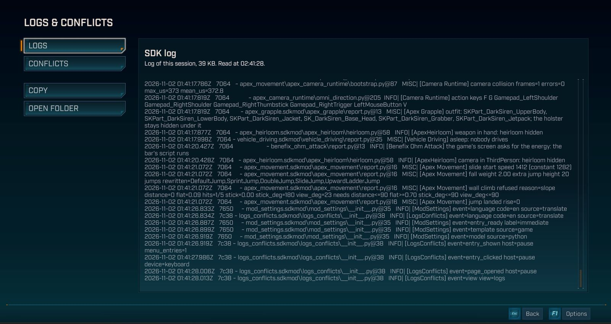
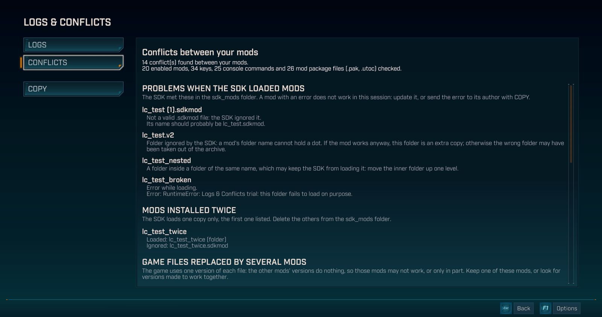

# Logs & Conflicts

Une page JOURNAUX ET CONFLITS (LOGS & CONFLICTS en anglais) dans le menu pause et le menu principal de
Borderlands 4 : le journal du SDK à copier en un clic, et les conflits entre tes mods.

Testé sur la version du jeu **1.11.0-4906557** (mise à jour du 22 octobre 2026), version Steam, sous Windows, au
clavier, à la souris et à la manette, avec 17 à 26 mods activés. En solo uniquement : jamais essayé en coopération.
Sous licence Mozilla Public License 2.0, contrairement au reste de ce dépôt : voir [LICENSE](LICENSE).

## Ce que fait le mod

Le journal
- Le journal du SDK de ta partie en cours s'affiche dans la page.
- Ton nom d'utilisateur Windows y est remplacé par `<user>` dans le chemin de ton dossier utilisateur
  (`C:\Users\...`).
- COPIER met le journal dans le presse-papiers, prêt à coller dans un signalement de bug.
- OUVRIR LE DOSSIER ouvre le dossier du journal.
- Un journal très long s'affiche en deux morceaux, le début et la fin ; COPIER copie ces deux morceaux, avec une ligne
  qui dit combien d'octets ont été coupés au milieu.

Les conflits
- La page montre ce qui empêche tes mods de marcher, ou de marcher ensemble, et dit quoi faire pour chaque sorte de
  conflit.
- Les mods que le SDK n'a pas pu charger, avec la raison : une erreur, un dossier mal nommé, un fichier `.sdkmod` non
  valide, ou un dossier rangé dans un dossier du même nom.
- Les mods installés deux fois, avec la copie que le SDK charge.
- Les fichiers du jeu remplacés par plusieurs paquets de mods (`.pak`, `.utoc`), avec celui qui passe devant.
- Les commandes console et les fichiers de réglages utilisés par deux mods.
- Les touches utilisées par plusieurs de tes mods activés, avec les mods et les actions qui les utilisent. Elles
  portent les noms que le jeu leur donne dans ses menus.
- Les problèmes les plus graves viennent en premier. Une sorte de conflit absente de ta partie ne s'affiche pas.
- COPIER copie cette liste en anglais, avec les noms de touches du SDK, pour l'envoyer à l'auteur d'un mod.
- Deux mods peuvent utiliser la même touche à des moments différents : la page les liste quand même.
- Une liste trop longue est coupée, et la page le dit.

Les textes de la page suivent la langue du jeu : anglais, français ou chinois simplifié, et anglais pour les autres.
Les noms des mods et de leurs actions restent ceux que chaque mod donne.

## Ouvrir et fermer la page

- Ouvre le menu pause, ou va au menu principal, puis choisis JOURNAUX ET CONFLITS.
- JOURNAL et CONFLITS passent d'une vue à l'autre ; LB et RB aussi, à la manette.
- Échap, ou B à la manette, ferme la page.

## Avec Mod Settings

- Logs & Conflicts marche seul, sans Mod Settings.
- Avec Mod Settings, les deux entrées apparaissent dans le menu : MODS et JOURNAUX ET CONFLITS.
- Tu peux éteindre Logs & Conflicts dans MODS : son entrée disparaît du menu tout de suite, et revient quand tu le
  rallumes.

## Vie privée

- Le mod lit seulement le journal du SDK, la liste de tes mods avec leurs touches, leurs commandes et leurs fichiers
  de réglages, et les paquets de mods du dossier Paks.
- Rien ne quitte ton PC : le mod n'envoie rien sur Internet.
- Le presse-papiers n'est touché que quand tu cliques sur COPIER.

## Installation

Le mod a deux fichiers sur sa page Nexus, et il faut les deux.

1. Installe le [SDK Python de Borderlands 4](https://github.com/bl-sdk/oak2-mod-manager/releases/latest).
2. Du fichier Logs and Conflicts, copie `logs_conflicts.sdkmod` dans `...\Borderlands 4\sdk_mods\`.
3. Du fichier Logs and Conflicts Paks, copie `logs-conflicts_1000_P.pak` dans `...\Borderlands 4\OakGame\Content\Paks\`.
4. Lance le jeu.

Pour désinstaller, supprime les deux fichiers. Le menu pause et le menu principal reviennent comme avant.

Le paquet remplace deux fichiers d'interface du jeu : le menu pause et le menu principal. Une mise à jour du jeu peut
les changer : si un de ces menus se comporte mal après une mise à jour, retire `logs-conflicts_1000_P.pak` en
attendant une mise à jour de Logs & Conflicts.

## Limites connues

- Seul le journal de la partie en cours s'affiche : le SDK le réécrit à chaque lancement du jeu.
- Les mods qui n'ont pas chargé et les mods installés deux fois sont lus dans ce journal : après une correction,
  relance le jeu pour voir la liste à jour.
- Les commandes console et les fichiers de réglages en double n'ont pas été essayés en jeu.
- Au menu principal, Échap qui ferme la page ouvre aussi la fenêtre pour quitter le jeu. Le jeu gère Échap lui-même à
  cet endroit. Clique Annuler pour rester dans le jeu. Dans le menu pause, Échap marche normalement.
- Le texte ne se sélectionne pas à la souris : utilise COPIER.
- Ton nom d'utilisateur n'est remplacé que dans le chemin de ton dossier utilisateur : relis le journal avant de le
  partager.
- Un autre mod qui remplace le menu pause ou le menu principal du jeu peut être en conflit.

## Fichiers

- `logs_conflicts/` : le paquet Python du mod, un petit service sur `127.0.0.1` qui lit le journal, ce que tes mods
  déclarent au SDK et la liste des fichiers des paquets de mods, et écrit dans le presse-papiers.
- `page/` : le script et le style de la page, portés par le paquet.
- `build_pak.py`, `pak_recipe.py`, `install_pak.py`, `game_tools.py` : fabriquent le paquet à partir des menus les
  plus récents du jeu, et l'installent. Ils demandent les outils de paquets de l'atelier, qui ne sont pas dans ce
  dépôt ; le fichier Nexus contient le paquet fabriqué.
- [`../menu_entries/`](https://github.com/Kevin-hDev/Mods-Borderlands-4/tree/main/menu_entries) : le fichier de
  menu partagé que porte le paquet, qui place les entrées dans les menus du jeu, sous la même licence.

## Tests

Lance chaque test séparément depuis ce dossier : `python test_routes.py`, ou `node test_page.js` pour la page. Les
tests Python remplacent le SDK et Windows par des doublures (`fixture_windows.py`) et fabriquent leurs propres
petits paquets (`fixture_paks.py`) ; ceux de la page exécutent son
script dans Node, avec des doublures de l'interface du jeu. Chaque test affiche une ligne `RESULTAT:` et sort avec un
code non nul en cas d'échec. Les tests du fichier de menu partagé sont dans son propre dossier.
