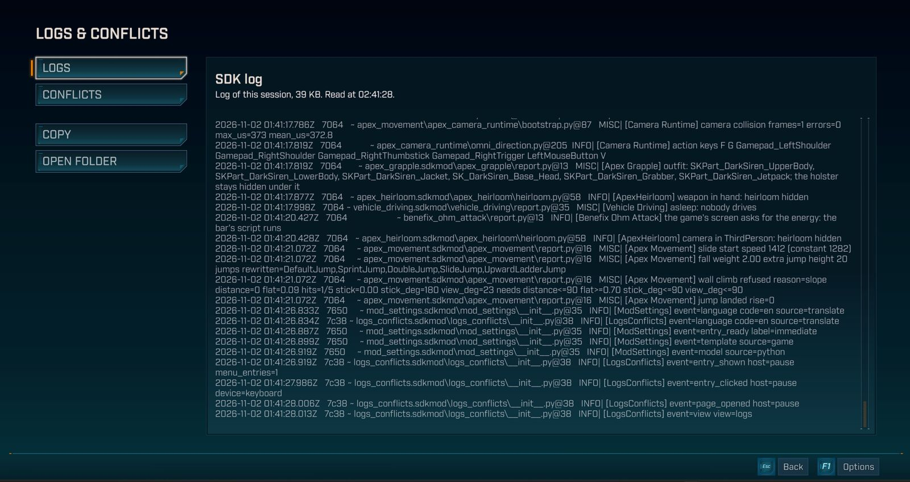
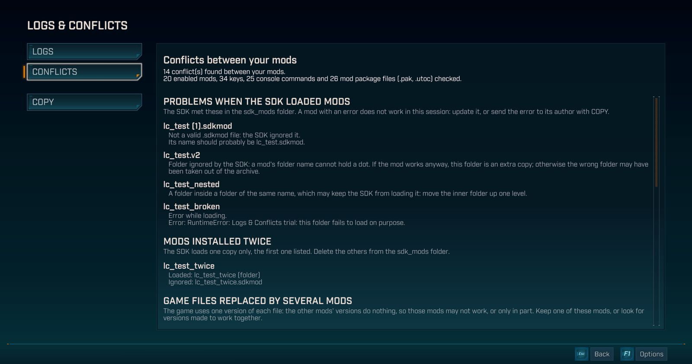

# Logs & Conflicts

『ボーダーランズ4』のポーズメニューとメインメニューにLOGS & CONFLICTSページを追加します。SDKのログをワンクリックでコピーでき、MOD同士の競合を確認できます。

ゲームのバージョン **1.11.0-4906557**（2026年10月22日のアップデート）で、Steam版、Windows、キーボード、マウス、コントローラーを使い、MODを17〜26個有効にした状態でテストしました。ソロのみで、協力プレイでは一度も試していません。このリポジトリのほかの部分とは異なり、Mozilla Public License 2.0で公開されています。[LICENSE](LICENSE)を参照してください。

## できること

ログ
- 現在のゲームセッションのSDKログがページに表示されます。
- ユーザーフォルダーのパス（`C:\Users\...`）に含まれるWindowsのユーザー名は `<user>` に置き換えられます。
- COPYでログをクリップボードに入れ、そのままバグ報告に貼り付けられます。
- OPEN FOLDERでログのフォルダーを開きます。
- とても長いログは、最初と最後の2つに分けて表示されます。COPYでもこの2つがコピーされ、途中で何バイト省略されたかを示す行が入ります。

競合
- MODが動かない原因や、MOD同士が一緒に動かない原因をページに表示し、競合の種類ごとに対処法を示します。
- SDKが読み込めなかったMODと、その理由：エラー、フォルダー名の誤り、無効な `.sdkmod` ファイル、または同じ名前のフォルダーの中に入ったフォルダー。
- 2回インストールされたMODと、SDKが読み込むほうのコピー。
- 複数のMODパッケージ（`.pak`、`.utoc`）に置き換えられたゲームファイルと、実際に使われるパッケージ。
- 2つのMODが使っているコンソールコマンドと設定ファイル。
- 有効にしている複数のMODが使っているキーと、それを使うMODとアクション。キーはゲームのメニューでの名前で表示されます。
- 最も深刻な問題が最初に表示されます。お使いのゲームで起きていない種類の競合は表示されません。
- COPYでこのリストを英語で、SDKのキー名のままコピーし、MODの作者に送れます。
- 2つのMODが同じキーを別々の場面で使っている場合もありますが、ページにはそれも表示されます。
- 長すぎるリストは途中で切れ、ページにそのことが表示されます。

ページの文章はゲームの言語に合わせて、英語、フランス語、簡体字中国語のいずれかで表示されます。それ以外の言語では英語になります。MODとそのアクションの名前は、各MODが付けた名前のままです。

## ページを開く・閉じる

- ポーズメニューを開くかメインメニューに行き、LOGS & CONFLICTSを選びます。
- LOGSとCONFLICTSで2つの画面を切り替えます。コントローラーではLBとRBでも切り替えられます。
- Esc、またはコントローラーのBでページを閉じます。

## Mod Settingsと一緒に使う

- Logs & ConflictsはMod Settingsがなくても単独で動きます。
- Mod Settingsがあると、メニューにMODSとLOGS & CONFLICTSの2つの項目が表示されます。
- MODSでLogs & Conflictsをオフにできます。その項目はすぐにメニューから消え、オンに戻すと再び表示されます。

## プライバシー

- このMODが読み込むのは、SDKのログ、MODの一覧とそのキー、コマンド、設定ファイル、Paksフォルダー内のMODパッケージだけです。
- データがPCの外に出ることはありません。このMODはインターネットに何も送信しません。
- クリップボードを使うのは、COPYをクリックしたときだけです。

## インストール

このMODのNexusページには2つのファイルがあり、両方とも必要です。

1. [『ボーダーランズ4』のPython SDK](https://github.com/bl-sdk/oak2-mod-manager/releases/latest)をインストールします。
2. Logs and Conflictsファイルから、`logs_conflicts.sdkmod` を `...\Borderlands 4\sdk_mods\` にコピーします。
3. Logs and Conflicts Paksファイルから、`logs-conflicts_1000_P.pak` を `...\Borderlands 4\OakGame\Content\Paks\` にコピーします。
4. ゲームを起動します。

アンインストールするには、2つのファイルを削除します。ポーズメニューとメインメニューは元に戻ります。

このパッケージは、ゲームのインターフェイスファイルのうち、ポーズメニューとメインメニューの2つを置き換えます。ゲームのアップデートでこれらが変わることがあります。アップデート後にどちらかのメニューの動作がおかしくなったら、Logs & Conflictsが更新されるまで `logs-conflicts_1000_P.pak` を取り除いてください。

## 既知の制限

- 表示されるのは現在のゲームセッションのログだけです。SDKは起動のたびにログを上書きします。
- 読み込めなかったMODと2回インストールされたMODは、このログから読み取ります。修正したら、ゲームを再起動して最新の一覧を確認してください。
- 重複したコンソールコマンドと設定ファイルは、ゲーム内ではまだ試していません。
- メインメニューでは、Escでページを閉じると、ゲームを終了するウィンドウも開きます。この場面ではゲーム自身がEscを処理しています。ゲームに残るには「キャンセル」をクリックしてください。ポーズメニューでは、Escは普通に動きます。
- 文章はマウスで選択できません。COPYを使ってください。
- ユーザー名が置き換えられるのはユーザーフォルダーのパスの中だけです。共有する前にログを読み返してください。
- ゲームのポーズメニューやメインメニューを置き換えるほかのMODとは、競合することがあります。

## ファイル

- `logs_conflicts/`：MODのPythonパッケージ。`127.0.0.1` で動く小さなサービスで、ログ、MODがSDKに伝えている内容、MODパッケージのファイル一覧を読み込み、クリップボードに書き込みます。
- `page/`：ページのスクリプトとスタイル。パッケージに含まれています。
- `build_pak.py`、`pak_recipe.py`、`install_pak.py`、`game_tools.py`：ゲームの最新のメニューからパッケージを作り、インストールします。作者専用のパッケージツールが必要で、それはこのリポジトリにはありません。Nexusのファイルには作成済みのパッケージが入っています。
- [`../menu_entries/`](https://github.com/Kevin-hDev/Mods-Borderlands-4/tree/main/menu_entries)：パッケージに含まれる共有メニューファイル。ゲームのメニューに項目を配置します。ライセンスは同じです。

## テスト

各テストはこのフォルダーから個別に実行します：`python test_routes.py`、ページのテストは `node test_page.js`。PythonのテストはSDKとWindowsをモック（`fixture_windows.py`）に置き換え、小さなパッケージを自分で作ります（`fixture_paks.py`）。ページのテストは、ゲームのインターフェイスのモックを使い、Node上でページのスクリプトを実行します。各テストは `RESULTAT:` の行を出力し、失敗したときは0以外のコードで終了します。共有メニューファイルのテストは、そのフォルダーにあります。
