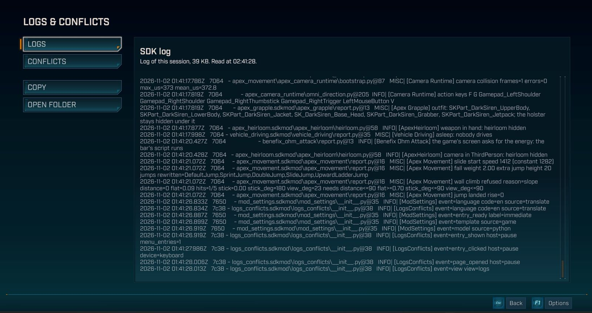
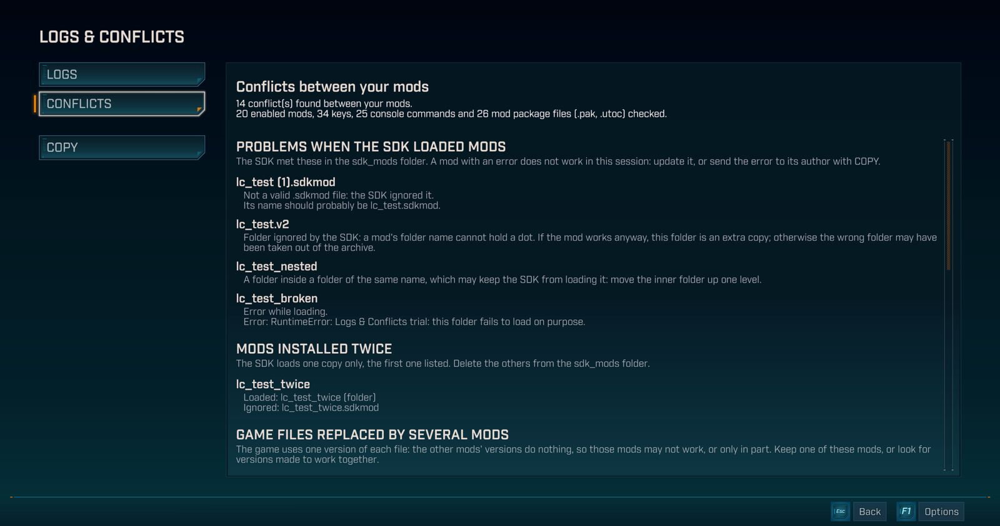

# Logs & Conflicts

A LOGS & CONFLICTS page in the pause menu and the main menu of Borderlands 4: the SDK's log, ready to copy in one
click, and the conflicts between your mods.

Tested on game version **1.11.0-4906557** (update of 22 October 2026), Steam version, on Windows, with keyboard, mouse
and gamepad, with 17 to 26 mods turned on. Solo only: never tried in co-op. Under the Mozilla Public License 2.0,
unlike the rest of this repository: see [LICENSE](LICENSE).

## What it does

The log
- The SDK's log of your current game shows in the page.
- Your Windows user name is replaced by `<user>` in the path of your user folder (`C:\Users\...`).
- COPY puts the log in the clipboard, ready to paste into a bug report.
- OPEN FOLDER opens the log's folder.
- A very long log shows in two parts, its start and its end; COPY copies these two parts, with a line that says how
  many bytes were cut in the middle.

The conflicts
- The page shows what keeps your mods from working, or from working together, and says what to do for each kind of
  conflict.
- Mods the SDK could not load, with the reason: an error, a badly named folder, an invalid `.sdkmod` file, or a folder
  inside a folder of the same name.
- Mods installed twice, with the copy the SDK loads.
- Game files replaced by several mod packages (`.pak`, `.utoc`), with the one that wins.
- Console commands and settings files used by two mods.
- Keys used by several of your enabled mods, with the mods and the actions that use them. They wear the names the
  game gives them in its menus.
- The most serious problems come first. A kind of conflict your game does not have is not shown.
- COPY copies this list in English, with the SDK's key names, to send to a mod's author.
- Two mods may use the same key at different moments: the page lists them anyway.
- A list too long is cut, and the page says so.

The page's texts follow the game's language: English, French or Simplified Chinese, and English for the others. The
names of the mods and of their actions stay the ones each mod gives.

## Opening and closing the page

- Open the pause menu, or go to the main menu, then choose LOGS & CONFLICTS.
- LOGS and CONFLICTS switch from one view to the other; LB and RB too, on a gamepad.
- Escape, or B on a gamepad, closes the page.

## With Mod Settings

- Logs & Conflicts works alone, without Mod Settings.
- With Mod Settings, both entries show in the menu: MODS and LOGS & CONFLICTS.
- You can turn Logs & Conflicts off in MODS: its entry leaves the menu at once, and comes back when you turn it on.

## Privacy

- The mod reads only the SDK's log, the list of your mods with their keys, their commands and their settings
  files, and the mod packages in the Paks folder.
- Nothing leaves your PC: the mod sends nothing to the Internet.
- The clipboard is touched only when you click COPY.

## Installing

The mod has two files on its Nexus page, and both are needed.

1. Install the [Borderlands 4 Python SDK](https://github.com/bl-sdk/oak2-mod-manager/releases/latest).
2. From the Logs and Conflicts file, copy `logs_conflicts.sdkmod` into `...\Borderlands 4\sdk_mods\`.
3. From the Logs and Conflicts Paks file, copy `logs-conflicts_1000_P.pak` into
   `...\Borderlands 4\OakGame\Content\Paks\`.
4. Launch the game.

To uninstall, delete both files. The pause menu and the main menu come back as they were.

The package replaces two of the game's interface files, the pause menu and the main menu. A game update can change
them: if one of these menus misbehaves after an update, remove `logs-conflicts_1000_P.pak` until Logs & Conflicts is
updated.

## Known limits

- Only the log of the current game shows: the SDK rewrites it at each launch.
- Mods that did not load and mods installed twice are read from this log: after a fix, launch the game again to see
  the list up to date.
- Duplicate console commands and settings files have not been tried in game.
- On the main menu, Escape closing the page also opens the game's window to quit. The game handles Escape itself
  there. Click Cancel to stay in the game. In the pause menu, Escape works normally.
- The text cannot be selected with the mouse: use COPY.
- Your user name is replaced only in the path of your user folder: read the log before you share it.
- Another mod that replaces the game's pause menu or main menu may conflict.

## Files

- `logs_conflicts/`: the mod's Python package, a small service on `127.0.0.1` that reads the log, what your mods
  declare to the SDK and the mod packages' file lists, and writes to the clipboard.
- `page/`: the page's script and style, carried in the package.
- `build_pak.py`, `pak_recipe.py`, `install_pak.py`, `game_tools.py`: build the package from the game's newest menus
  and install it. They need the workshop's pak tools, which are not in this repository; the Nexus file holds the
  built package.
- [`../menu_entries/`](https://github.com/Kevin-hDev/Mods-Borderlands-4/tree/main/menu_entries): the shared menu
  file the package carries, which places the entries in the game's menus, under the same licence.

## Tests

Run each test separately from this folder: `python test_routes.py`, or `node test_page.js` for the page. The Python
tests replace the SDK and Windows with stand-ins (`fixture_windows.py`) and build small packages of their own
(`fixture_paks.py`); the page's tests run its script in Node with
stand-ins for the game's interface. Each test prints a `RESULTAT:` line and exits with a non-zero code on failure. The
shared menu file's tests are in its own folder.
