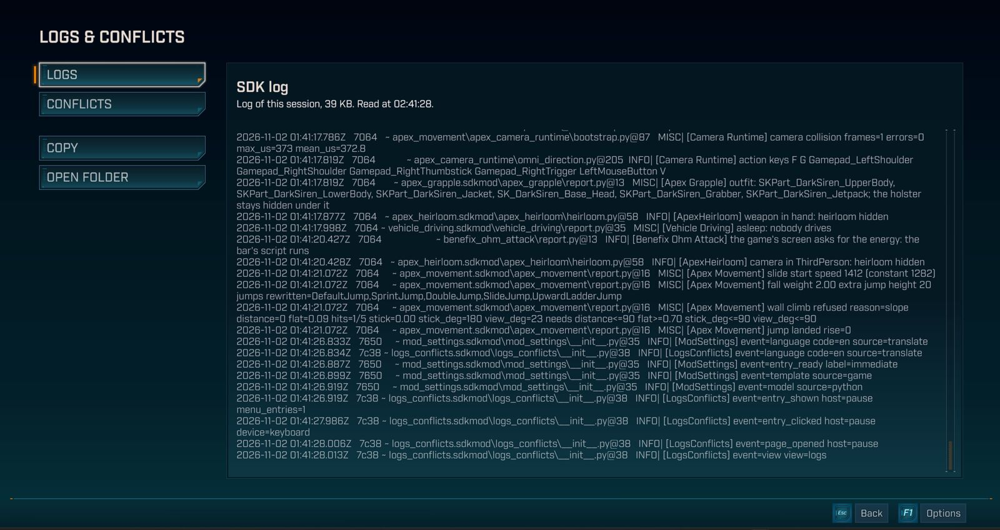
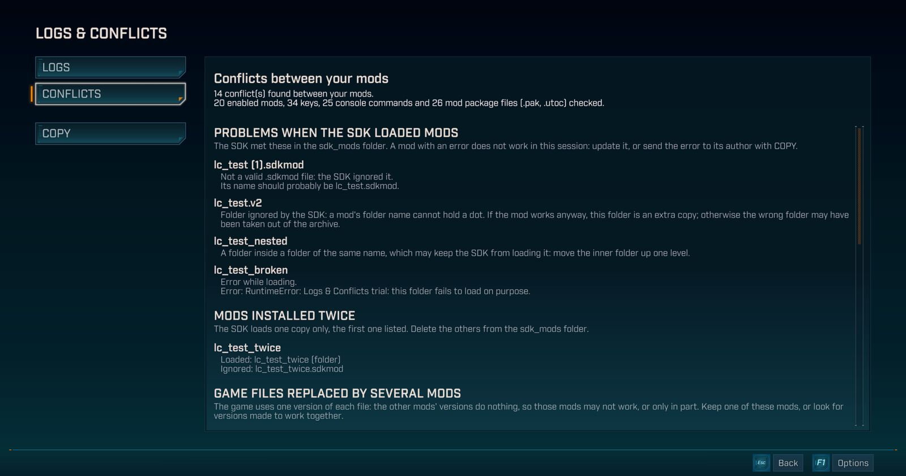

# Logs & Conflicts

在《无主之地 4》的暂停菜单和主菜单中加入「日志与冲突」（LOGS & CONFLICTS）页面：一键复制 SDK 日志，并查看你的模组之间的冲突。

已在游戏版本 **1.11.0-4906557**（2026 年 10 月 22 日的更新）上测试：Steam 版，Windows，键盘、鼠标和手柄，启用了 17 到 26 个模组。仅限单人模式：从未在合作模式下试过。与本仓库的其他部分不同，它采用 Mozilla Public License 2.0 许可：见 [LICENSE](LICENSE)。

## 功能

日志
- 页面中显示你当前游戏会话的 SDK 日志。
- 你的用户文件夹路径（`C:\Users\...`）中的 Windows 用户名会被替换为 `<user>`。
- 「复制」把日志放进剪贴板，可以直接粘贴到错误报告中。
- 「打开文件夹」打开日志所在的文件夹。
- 很长的日志分成两段显示：开头和结尾；「复制」也只复制这两段，并用一行说明中间截掉了多少字节。

冲突
- 页面显示妨碍你的模组运行、或妨碍它们一起运行的问题，并说明每种冲突该怎么处理。
- SDK 无法加载的模组，并附上原因：出现错误、文件夹名称不正确、`.sdkmod` 文件无效，或文件夹被放在同名文件夹里。
- 安装了两次的模组，并说明 SDK 加载的是哪一份。
- 被多个模组包（`.pak`、`.utoc`）替换的游戏文件，并说明最终生效的是哪一个。
- 被两个模组同时使用的控制台命令和设置文件。
- 被你启用的多个模组同时使用的按键，以及使用它们的模组和动作。按键使用游戏菜单中的名称。
- 最严重的问题排在最前面。你的游戏中没有的冲突类型不会显示。
- 「复制」会用英文复制这份列表，并使用 SDK 的按键名称，方便发给模组作者。
- 两个模组可能在不同时刻使用同一个按键：页面仍会把它们列出来。
- 列表太长时会被截断，页面会说明这一点。

页面的文字跟随游戏语言：英文、法文或简体中文，其他语言显示英文。模组及其动作的名称保持每个模组自己给出的名称。

## 打开和关闭页面

- 打开暂停菜单，或进入主菜单，然后选择「日志与冲突」。
- 「日志」和「冲突」用来切换两个视图；使用手柄时也可以按 LB 和 RB。
- 按 Esc，或手柄上的 B，关闭页面。

## 与 Mod Settings 一起使用

- Logs & Conflicts 不需要 Mod Settings 也能单独使用。
- 安装了 Mod Settings 时，菜单中会同时出现两个入口：「模组」和「日志与冲突」。
- 你可以在「模组」中关闭 Logs & Conflicts：它的入口会立即从菜单中消失，重新开启后又会出现。

## 隐私

- 本模组只读取 SDK 日志、你的模组列表及其按键、命令和设置文件，以及 Paks 文件夹中的模组包。
- 所有内容都留在你的电脑上：本模组不会向互联网发送任何内容。
- 只有在你点击「复制」时才会使用剪贴板。

## 安装

本模组在 Nexus 页面上有两个文件，两个都需要。

1. 安装[《无主之地 4》Python SDK](https://github.com/bl-sdk/oak2-mod-manager/releases/latest)。
2. 从 Logs and Conflicts 文件中，把 `logs_conflicts.sdkmod` 复制到 `...\Borderlands 4\sdk_mods\`。
3. 从 Logs and Conflicts Paks 文件中，把 `logs-conflicts_1000_P.pak` 复制到 `...\Borderlands 4\OakGame\Content\Paks\`。
4. 启动游戏。

卸载时，删除这两个文件即可。暂停菜单和主菜单会恢复原样。

模组包替换了游戏的两个界面文件：暂停菜单和主菜单。游戏更新可能会改动它们：如果更新后其中某个菜单出现异常，请先移除 `logs-conflicts_1000_P.pak`，等待 Logs & Conflicts 更新。

## 已知限制

- 只显示当前游戏会话的日志：SDK 每次启动游戏时都会重写它。
- 未能加载的模组和安装了两次的模组是从这份日志中读取的：修正之后，请重新启动游戏查看最新列表。
- 重复的控制台命令和设置文件尚未在游戏中试过。
- 在主菜单中，按 Esc 关闭页面时也会打开退出游戏的窗口。游戏在那里自己处理 Esc。点击「取消」即可留在游戏中。在暂停菜单中，Esc 正常工作。
- 无法用鼠标选择文字：请使用「复制」。
- 你的用户名只会在用户文件夹的路径中被替换：分享日志之前请先看一遍。
- 其他替换游戏暂停菜单或主菜单的模组可能会与它冲突。

## 文件

- `logs_conflicts/`：本模组的 Python 包，一个运行在 `127.0.0.1` 上的小服务，读取日志、你的模组向 SDK 声明的内容和模组包的文件列表，并写入剪贴板。
- `page/`：页面的脚本和样式，随包提供。
- `build_pak.py`、`pak_recipe.py`、`install_pak.py`、`game_tools.py`：用游戏最新的菜单制作模组包并安装。它们需要作者自己的模组包工具，这些工具不在本仓库中；Nexus 上的文件里有制作好的模组包。
- [`../menu_entries/`](https://github.com/Kevin-hDev/Mods-Borderlands-4/tree/main/menu_entries)：模组包携带的共享菜单文件，负责把入口放进游戏菜单，采用相同的许可。

## 测试

在本文件夹中分别运行每个测试：`python test_routes.py`，页面的测试用 `node test_page.js`。Python 测试用替身（`fixture_windows.py`）代替 SDK 和 Windows，并自己制作小型模组包（`fixture_paks.py`）；页面的测试在 Node 中运行它的脚本，并用替身代替游戏界面。每个测试都会输出一行 `RESULTAT:`，失败时以非零代码退出。共享菜单文件的测试在它自己的文件夹中。
