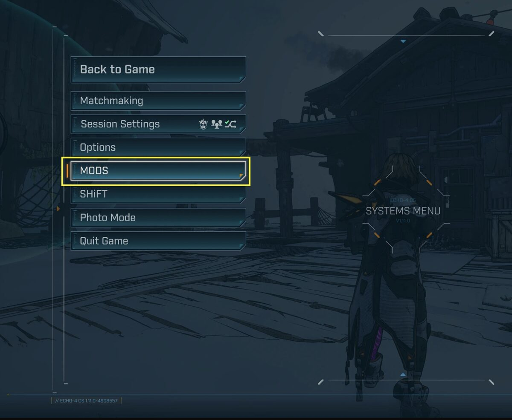
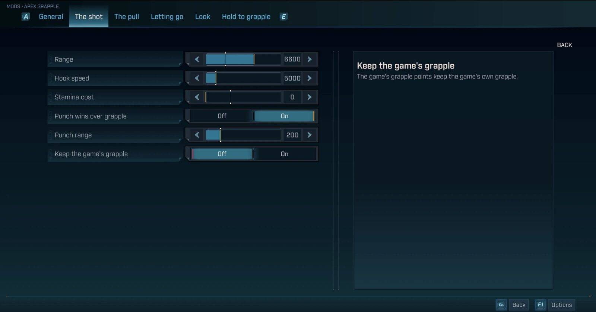

# How it works

Mod Settings is two files: an interface pak, `mod-settings_999_P.pak`, which draws MODS in the game's menu, and a
Python mod, `mod_settings.sdkmod`, which reads and sets the SDK's mods. This page explains what happens between the
two, so you know what Mod Settings touches, and what it does not.

## The path of a setting

1. The pak replaces the game's pause menu and main menu with copies that have one more entry, MODS.
2. When you open MODS, the page borrows the pieces of the game's Options screen: switches, sliders, lists, keys and
   tabs. That is why it has the game's look, sounds and controls.
3. The page asks the Python mod for the list of mods, through a local service on your PC.
4. The Python mod reads the SDK's list of mods and the options each one declares, like the SDK console's mods menu.
5. When you change a setting, the page sends the new value. The Python mod checks that it fits what the mod accepts,
   then gives it to the mod, exactly like the console.
6. The SDK saves the setting in `...\Borderlands 4\sdk_mods\settings\`, in the mod's file.

Mod Settings keeps no settings of its own: each value lives in the mod that declares it, and MODS only shows it, like
the console.

## When a change counts

- **The mod gets the value at once.** What it does with it, and when, depends on the mod.
- **A slider being dragged** sends its value every 100 milliseconds at most, and always the last one.
- **A change is saved at once**, except a slider's: it is saved when you close MODS, or at the next change of another
  setting. If the game crashes before, that slider's last value is lost.

## Each time MODS opens

MODS reads the list of mods and their settings again each time it opens, and a first time when the game loads the
pause menu or the main menu. A setting changed elsewhere, in the SDK console or in a mod's own window, therefore
shows the next time it opens.

This reading freezes the game for a short moment, never outside the menus: 0.2 to 0.35 seconds the first time after
the game starts, then a few milliseconds to 50 milliseconds, with 22 to 29 mods installed (measured in game). With the menus closed, Mod
Settings does nothing.

## The game's files, and its updates

- The pak holds copies of the game's pause menu and main menu, made from the tested version, 1.11.0-4906557. The game
  loads them instead of its own.
- If a game update changes these menus, the pak keeps its old copies: the menus may then miss something new or
  misbehave, until Mod Settings is updated. Removing the pak gives the game its own menus back, and your settings do
  not change.
- Another mod that also replaces the pause menu or the main menu conflicts with Mod Settings: only one of the two can
  win.
- These copies belong to Gearbox Software and 2K. That is why the pak is only on Nexus, and not in this repository.

## The local service, and why web pages are refused

The page and the Python mod talk through a small service on your PC.

- **It only listens to your PC** (`127.0.0.1`, port 38791). Nothing goes out to the Internet or to the game's
  network, in co-op either.
- **It refuses web pages.** It refuses any request that comes from a web page open in your browser. Without this, a
  site you visit while you play could send requests to this service and change your mods' settings. Only the game's
  interface and the programs on your own PC can use it.
- **Each request is small and checked**: its content is 512 bytes at most, and a value outside what the mod accepts
  is refused.
- If another program already uses this port, Mod Settings does not start, and the SDK log says so (see
  [troubleshooting](TROUBLESHOOTING.md)).

## Why limits

MODS has a ceiling for each list: number of mods, of options, of choices, length of texts. Without them, a mod that
declared thousands of options could make the page huge and freeze the game each time it opens. Beyond a limit, MODS
hides or cuts what goes over, while the SDK console shows it. The values are in the
[guide for mod authors](MOD_AUTHORS.md), under "Limits".
