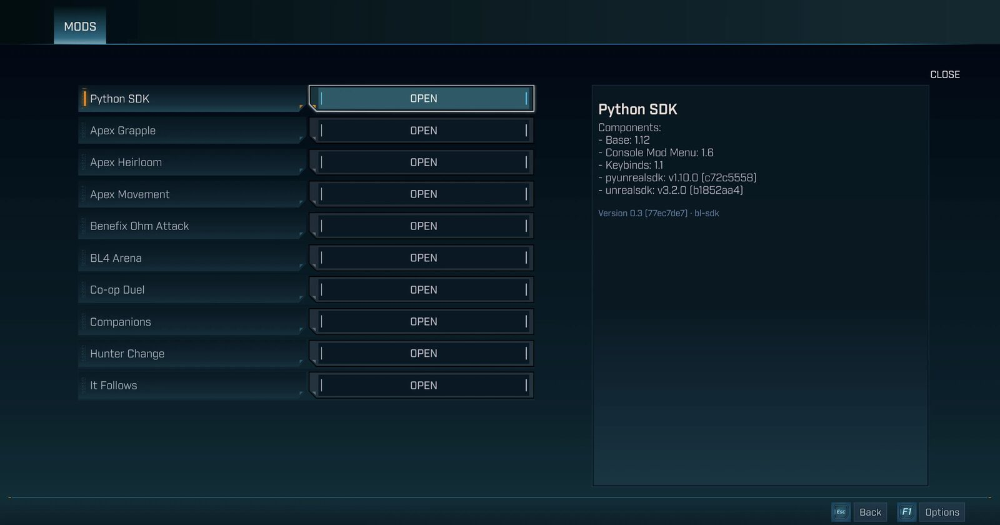
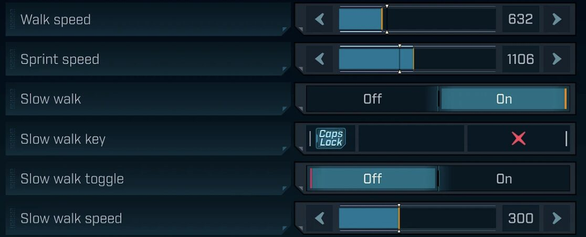
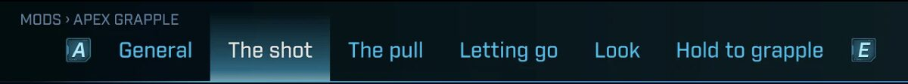

# Mod Settings : guide pour les créateurs de mods

[English](MOD_AUTHORS.md) · [中文](MOD_AUTHORS.zh.md) · [日本語](MOD_AUTHORS.ja.md)

Mod Settings ajoute une entrée MODS au menu pause et au menu principal de Borderlands 4. Elle montre et règle les
options de tous les mods du SDK Python, avec les pièces de l'écran Options du jeu.

Ce guide explique comment ton mod apparaît dans MODS, et comment écrire tes options pour qu'elles s'y affichent bien.

## En bref

- **Tu n'as rien à installer, importer ni appeler.** MODS lit ce que ton mod déclare à `mods_base`, exactement comme
  le menu des mods de la console du SDK.
- **Ton mod ne dépend pas de Mod Settings.** Sans lui, il marche pareil. Ne cherche pas à savoir s'il est installé.
- **Ce qui s'affiche dans la console s'affiche dans MODS**, avec les limites données plus bas.

## Ce que MODS montre de ton mod

- **La liste des mods** : tous les mods du SDK, dans l'ordre du menu de la console.
- **La page de ton mod** : ton nom, tes options, et un panneau de description. Dans l'onglet Général, quand le joueur
  ne survole aucune option, ce panneau montre la description de ton mod, puis sa version et son auteur.
- **L'interrupteur Activé**, en tête de l'onglet Général, si ton mod peut être allumé et éteint.
- **« Aucun réglage »** quand ton mod n'a aucune option visible et ne peut pas être allumé ni éteint, et dans tout
  onglet vide.



Le nom, la description, la version et l'auteur sont ceux de ton objet `Mod`, que `build_mod()` remplit depuis ton
`pyproject.toml` ou ton module.

## Les types d'options

| Option du SDK | Dans MODS | Ce que MODS lit |
|---|---|---|
| `BoolOption` | un interrupteur | `true_text` et `false_text` comme textes des deux positions |
| `SliderOption` | un curseur | `min_value`, `max_value`, `step`, `is_integer` ; autant de décimales que le pas, 3 au plus (un pas plus petit que 0,0005 n'en donne aucune) ; aucune avec `is_integer`, qui vaut `True` par défaut : passe `is_integer=False` pour un curseur à décimales |
| `SpinnerOption` | un choix à flèches | `choices` ; `wrap_enabled` n'est pas lu |
| `DropdownOption` | une liste déroulante | `choices` |
| `KeybindOption` | une touche | le joueur clique, puis appuie sur la nouvelle touche ; Échap annule. Seuls sont acceptés les lettres, les chiffres, F1 à F12, les flèches, les touches de contrôle, le pavé numérique et les boutons droit, milieu et latéraux de la souris, et la capture s'arrête au bout de 10 secondes sans touche. Avec `is_rebindable=False`, la touche est affichée sans pouvoir être changée |
| `ButtonOption` | un bouton | `on_press` |
| `GroupedOption` | un titre de section au-dessus de ses options | `display_name` |
| `NestedOption` | un onglet, un sous-onglet ou une page | voir « Ranger tes options » |



Une sous-classe de l'un de ces types s'affiche comme lui. Une option d'une autre classe ne s'affiche pas, pas plus
qu'une option cachée (`is_hidden=True`, dont `HiddenOption`).

## Ranger tes options

MODS range la page de ton mod en onglets, avec la même règle pour tous les mods :

1. Les options qui ne sont dans aucune `NestedOption` vont dans un onglet **Général**.
2. Chaque `NestedOption` du premier niveau devient un **onglet**, nommé par son `display_name`.
3. Dans un onglet, chaque `NestedOption` devient un **sous-onglet**. Les autres options de cet onglet vont dans un
   sous-onglet Général.
4. Plus profond, une `NestedOption` devient une ligne **Ouvrir**, qui ouvre un écran rangé de la même façon. Au-delà
   de 4 niveaux, elle n'est pas affichée.
5. Une `GroupedOption` met un **titre de section** au-dessus de ses options. Un titre suivi directement d'un autre
   titre n'est pas affiché. Les groupes emboîtés sont mis à plat : une option placée après un groupe intérieur
   s'affiche sous le titre de ce groupe. Un groupe qui ne contient que des pages ne montre pas de titre, sauf si une
   option hors du groupe le suit : son titre s'affiche alors au-dessus d'elle.



Le SDK range de lui-même tes options dans un groupe « Options » et tes touches (`@keybind`) dans un groupe
« Keybinds » (`Mod.iter_display_options`). Par défaut, l'onglet Général montre donc le titre « Options », et « Keybinds » si ton mod a
des touches. Si ta première option est un groupe, « Options » n'est pas affiché (règle 5). Si ton mod
redéfinit `iter_display_options`, MODS suit ce qu'elle donne, comme la console.

Par exemple :

```python
options=[
    BoolOption(...),                                        # General tab
    NestedOption("combat", [...], display_name="Combat"),   # "Combat" tab
    NestedOption("movement", [                              # "Movement" tab
        SliderOption(...),                                  #   its General sub-tab
        NestedOption("dash", [...], display_name="Dash"),   #   "Dash" sub-tab
    ], display_name="Movement"),
]
```

**Passe tes options à `build_mod(options=[...])`.** Sans cet argument, `build_mod()` ramasse les options de ton module
dans un ordre qui peut changer, et il ignore les `GroupedOption` et les `NestedOption`. Donne aussi un `display_name`
à chaque `NestedOption` : sans lui, l'onglet porte l'identifiant tel quel (« combat »).

## Le panneau de description

- Quand le joueur survole une option, le panneau montre son `description_title` (par défaut son `display_name`) et sa
  `description`.
- Le SDK convertit le HTML de la description en texte : `<br>` devient un retour à la ligne. MODS l'affiche comme du
  texte et réunit les lignes vides qui se suivent.
- Quand rien n'est survolé, le panneau montre, dans l'onglet Général, la description de ton mod ; dans un autre
  onglet ou sous-onglet, celle de sa `NestedOption`, et rien si elle n'en a pas.

## Quand un changement arrive dans ton mod

- MODS écrit `option.value = new_value` sur le fil du jeu, comme la console. Le SDK appelle alors
  `on_change_anytime`, puis `on_change_while_enabled` si ton mod est allumé.
- **Ces fonctions sont appelées avant que la valeur change.** Lis la nouvelle valeur dans leur argument `value` :
  `option.value` contient encore l'ancienne.
- **Un curseur qu'on fait glisser envoie une valeur toutes les 100 ms au plus**, et toujours la dernière. Ta fonction
  peut donc être appelée dix fois par seconde : garde-la légère, sans écriture de fichier ni recherche coûteuse.
- Un bouton appelle `on_press(option)`, sur le fil du jeu lui aussi.
- L'interrupteur Activé appelle `mod.enable()` ou `mod.disable()`, comme la console.
- L'enregistrement passe par `mod.save_settings()`, celui du SDK : tout de suite après un changement, et pour un
  curseur, à la fermeture de MODS ou au changement suivant d'un autre réglage. Un bouton n'enregistre rien.

## Les limites

| Quoi | Limite | Au-delà |
|---|---|---|
| Mods | 64 | les suivants ne sont pas affichés |
| Lignes, tous mods confondus | 3 000 | les suivantes ne sont pas affichées |
| Lignes sur une même page | 100 | les suivantes ne sont pas affichées |
| Niveaux de pages | 4 | les pages plus profondes ne sont pas affichées |
| Nom d'une option ou d'un choix | 80 caractères | coupé |
| Description | 600 caractères | coupée |
| Choix d'une liste ou d'un choix à flèches | 64 | l'option entière n'est pas affichée |

Une ligne, c'est une option, mais aussi un titre de section, un onglet ou l'interrupteur Activé. Au premier niveau,
les 100 lignes couvrent ensemble l'onglet Général et les onglets. Un titre ou un onglet coupé emporte tout ce qu'il
contient.

Ne s'affichent pas non plus :
- une liste sans choix, ou dont un choix n'est pas du texte ;
- un curseur dont le minimum n'est pas plus petit que le maximum, ou dont une borne, le pas ou la valeur est NaN ou
  infini ;
- une touche dont le nom n'est pas fait de 1 à 32 lettres ou chiffres, par exemple une touche de manette. La ligne
  `MODEL_BUILT` ne la compte pas.

Si la fonction qui liste tes options échoue, ou si la valeur d'un curseur n'est pas un nombre du tout (`None`, du
texte), MODS montre ce qui venait avant, et compte ton mod dans `failed_mods`.

## Les langues

Les textes de MODS suivent la langue du jeu : anglais, français ou chinois simplifié, et anglais pour les autres
langues. Les noms et les descriptions de tes options s'affichent tels que ton mod les donne : MODS ne les traduit pas.

## Conseils

- Passe tes options à `build_mod(options=[...])`, dans l'ordre où tu veux les voir.
- Donne des noms courts, et une description à chaque option : c'est elle que le joueur lit dans le panneau.
- Regroupe les options proches avec une `GroupedOption`, et sépare les sujets avec des `NestedOption`. Deux niveaux
  suffisent pour que tout tienne en onglets et sous-onglets.
- Garde tes fonctions `on_change` légères, et lis la nouvelle valeur dans leur argument.
- Cache les valeurs internes de ton mod avec `is_hidden=True` ou une `HiddenOption`.

## Vérifier ton mod

1. Installe Mod Settings : ses deux fichiers, `mod_settings.sdkmod` et `mod-settings_999_P.pak` (voir le README).
2. Lance le jeu, ouvre le menu pause, choisis MODS, puis ton mod.
3. Compare avec le menu des mods de la console du SDK : tu dois y retrouver les mêmes options.
4. S'il manque quelque chose, cherche dans `unrealsdk.log` la ligne `[ModSettings] MODEL_BUILT`. Elle donne des
   totaux pour tous les mods ensemble, sans dire lequel : `unsupported` (type inconnu, valeurs invalides, ou plus de
   64 choix), `truncated` (lignes, onglets ou mods coupés par une limite, chaque coupure comptant pour 1) et
   `failed_mods` (nombre de mods dont la liste a échoué). Les options cachées n'y sont pas comptées.

## Exemple complet

```python
from mods_base import (BoolOption, ButtonOption, GroupedOption, NestedOption, SliderOption, SpinnerOption,
                       build_mod)


def on_speed(option: SliderOption, value: float) -> None:
    # value is the new value: option.value still holds the old one here.
    ...


speed = SliderOption("speed", 100, 50, 300, step=10, display_name="Speed",
                     description="Movement speed, in percent.", on_change_anytime=on_speed)
enabled_in_air = BoolOption("in_air", True, display_name="In the air",
                            description="Also works while jumping or falling.")
quality = SpinnerOption("quality", "Medium", ["Low", "Medium", "High"], display_name="Quality",
                        description="Visual quality of the effect.")
reset = ButtonOption("reset", display_name="Reset", description="Puts every setting back to its default.",
                     on_press=lambda _option: ...)

build_mod(options=[
    GroupedOption("main", [speed, enabled_in_air], display_name="Movement"),  # General tab, "Movement" section
    NestedOption("effects", [quality, reset], display_name="Effects",          # "Effects" tab
                 description="How the effect looks."),
])
```
