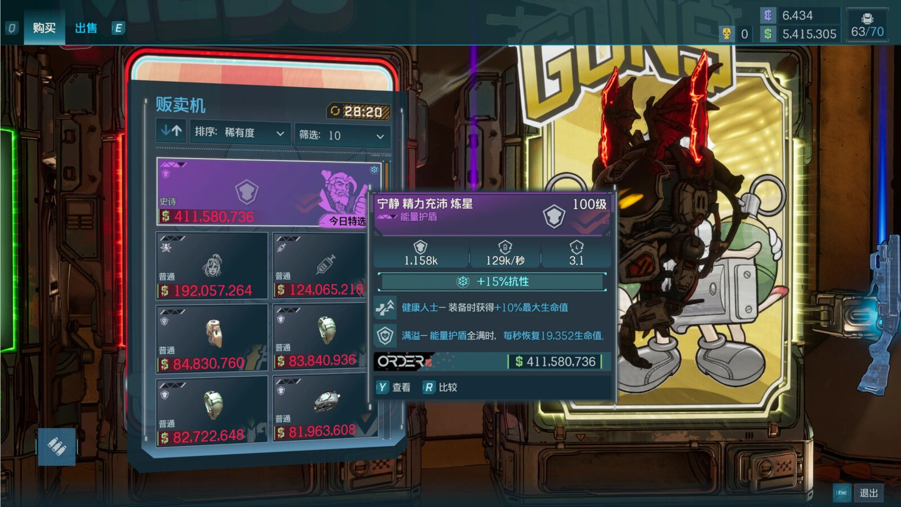
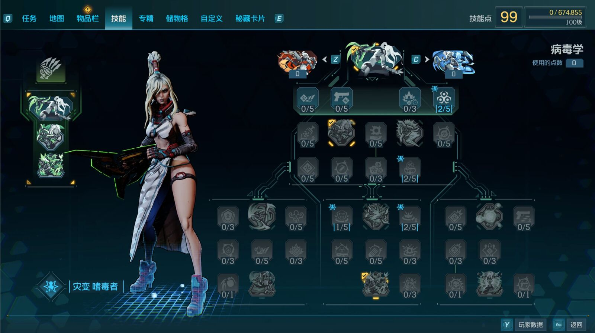

# BetterRewards

BetterRewards réunit des récompenses ajustées pour le jeu en solo en Difficile et en Chasseur de l'Arche ultime (UVH), un niveau maximum porté à 100, encore expérimental, et une fonction de retour au jeu d'origine (Return to vanilla and disable). Son créateur l'a conçu pour une progression du personnage plus longue, moins de farm répétitif, et une raison de continuer à chercher un meilleur équipement. C'est une bêta publique.

{: width="1600" height="902" loading="lazy"}

## Expérience et argent

| Mode en cours | XP du personnage | XP de spécialisation débloquée | Argent gagné |
|---|---|---|---|
| Difficile, sans UVH actif | ×1,25 | ×1,25 | ×1,25 |
| UVH | ×1,30 | ×1,30 | ×1,30 |

Ces multiplicateurs s'appliquent aux récompenses réelles du jeu d'origine dans chaque mode. Les bonus de Difficile et d'UVH se remplacent l'un l'autre ; ils ne se cumulent pas. Tous les rangs d'UVH pris en charge aujourd'hui ont les mêmes réglages, qui pourront varier selon la difficulté ou le rang d'UVH dans de prochaines mises à jour.

- Le bonus de spécialisation ne s'applique qu'une fois la spécialisation débloquée.
- Les prix d'achat et les autres monnaies ne changent pas.
- Seul le jeu en solo en Difficile et en UVH est ajusté. Les récompenses en Facile et en Normal ne changent pas.
- Les ennemis ne reçoivent aucun multiplicateur de dégâts, de vie ou de nombre, même si les niveaux et les points de compétence en plus rendent le joueur plus fort.

## Choisis ton réglage de butin : n'en installe qu'un

| Réglage | Difficile | UVH |
|---|---|---|
| Standard | ×1,50 | ×1,75 |
| Enhanced | ×3,00 | ×3,50 |
| Insane | ×10,00 | ×12,00 |
| MaxLoot | ×10 000 | ×10 000 |

Les réglages modifient le poids des objets légendaires et nacrés dans le butin, et les chances de butin propre à chaque boss pris en compte. MaxLoot sert aux essais ou au plaisir du butin à profusion. Les quatre réglages ont aujourd'hui les mêmes multiplicateurs d'expérience et d'argent.

## Niveau 100 (expérimental)

- Après avoir fini l'histoire principale et débloqué l'UVH, entre en UVH en solo avec BetterRewards activé : ce personnage est alors inscrit pour le niveau maximum 100.
- Le personnage reste inscrit quand tu reviens à une autre difficulté en solo.
- Un personnage déjà entré en UVH avant doit y entrer à nouveau avec le mod activé pour être inscrit.
- Aucun niveau, aucune expérience ni aucun point de compétence n'est donné directement : continue à monter de niveau normalement.
- Les niveaux 71 à 100 donnent leurs points de compétence comme d'habitude, soit 30 points de compétence de personnage en plus au total.
- L'équipement et les ennemis suivent les règles de niveau habituelles du jeu ; certains ennemis peuvent dépasser le niveau 100.

{: width="1600" height="898" loading="lazy"}

## Installation

BetterRewards a besoin du BL4 PythonSDK de la communauté (Oak2 Mod Manager), à installer à part : [guide d'installation](https://bl-sdk.github.io/oak2-mod-db/).

1. Sauvegarde et quitte complètement le jeu, puis fais une copie de tes sauvegardes de personnage et des sauvegardes partagées.
2. Installe le BL4 PythonSDK en suivant son guide.
3. Télécharge un des quatre ZIP, un par réglage de butin, sur la page Nexus.
4. Extrais son dossier `bl4_hard_rewards` dans le dossier `sdk_mods` du jeu.
5. Active BetterRewards dans le menu Mods du SDK si besoin.

Pour mettre à jour ou changer de réglage, remplace les fichiers fournis dans le même dossier. Garde ton `level80_unlocks.json`, les réglages du SDK, `return_python_backups`, `return_python_state.json` et les anciennes copies `return_jobs` s'il y en a. Ne renomme pas de dossier pour faire tourner plusieurs copies.

Un mod désactivé après un retour au jeu d'origine reste désactivé jusqu'à ce que tu le réactives. Si tu as déjà confirmé Return to vanilla, laisse-le aller au bout et attends « Saved data verified; Mod DISABLED » avant de mettre à jour ou de changer de réglage.

## Avant de désinstaller ou de revenir au jeu d'origine

**Ne supprime pas simplement le mod pour charger ensuite un personnage de haut niveau.** Le retour baisse les niveaux, et réactiver le mod ne rend pas ta progression de haut niveau.

Pour désinstaller le mod et revenir au jeu d'origine :

1. Sauvegarde normalement, et coupe temporairement Steam Cloud pour ce jeu.
2. Déplace l'équipement au-dessus du niveau 70 depuis la banque, Lost Loot et le Reward Center vers le sac du personnage en cours, puis sauvegarde à nouveau. Les récompenses des boss mondiaux sont dans le Reward Center, pas dans Lost Loot.
3. Charge un personnage en solo et sors de tout véhicule. Trouve BetterRewards dans le menu Mods du SDK, choisis Return to vanilla and disable, ou Disable, puis lis et confirme le message.
4. Attends « Converted; guard remains ON », puis sauvegarde tout de suite et reviens au menu principal. Ne continue pas à farmer.
5. Au menu principal, attends « Saved data verified; Mod DISABLED ». Le retour n'est terminé qu'une fois ce message affiché. Quitte complètement le jeu, relance-le, et vérifie ton personnage, ton équipement et tes points de compétence.

Les messages du mod s'affichent en chinois et en anglais, et son choix de menu s'écrit « 返回原版并停用 / Return to vanilla and disable ».

Si le mod trouve des données de haut niveau sur un autre personnage, dans les données partagées ou dans des objets non récupérés, la conversion s'arrête et le mod reste activé. Ne le désinstalle pas avant d'avoir vu « Saved data verified; Mod DISABLED ». Une opération ne convertit qu'un seul personnage de haut niveau.

Ce que le retour change :

- Un personnage au-dessus du niveau 70 redescend au niveau 70, avec 69 points de compétence de personnage au total. Ses compétences de personnage sont remises à zéro et doivent être réattribuées.
- L'équipement porté ou équipé au-dessus du niveau 70 redescend au niveau 70, avec des statistiques ajustées à son nouveau niveau.
- La spécialisation, l'argent et l'avancée des missions sont gardés.

Le retour commence par une copie locale des derniers fichiers sauvegardés de tout le compte. La conversion elle-même porte sur le personnage chargé et les objets qu'il porte ou équipe. Les copies sont dans `bl4_hard_rewards/return_python_backups/job-id/original` : mets-les en lieu sûr hors du dossier du mod avant de retirer le mod. Si tu as utilisé une ancienne version et que tu as un dossier `return_jobs`, garde aussi ses copies.

Tout se passe sur ton ordinateur ; aucune sauvegarde n'est envoyée en ligne, et il ne faut ni PowerShell, ni navigateur, ni outil extérieur. La vérification automatique prend en charge l'organisation des sauvegardes de Steam sur Windows, avec un seul dossier de compte Steam identifiable.

## Compatibilité

- Windows x64, Steam, jeu en solo.
- Cette version est adaptée au BuildID Steam 26007962. Après une mise à jour du jeu, vérifie la compatibilité sur la page Nexus avant de charger un personnage de haut niveau.
- Évite de l'associer à d'autres mods ou trainers qui modifient les mêmes systèmes d'expérience, d'argent, de butin ou de niveau maximum.

## Signaler un bug

Signale les bugs sur la page Nexus, avec :

- ta version de BetterRewards ;
- ton réglage de butin ;
- la difficulté de ta partie ;
- tes autres mods installés ;
- ce que tu faisais quand le problème est arrivé.
