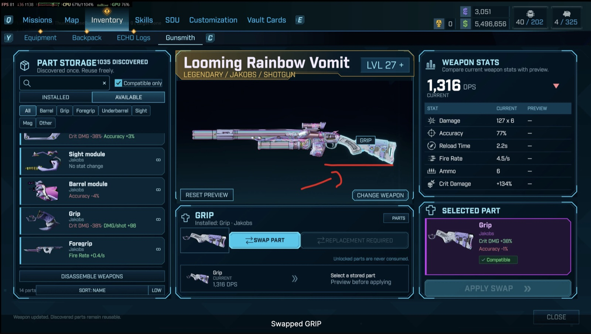
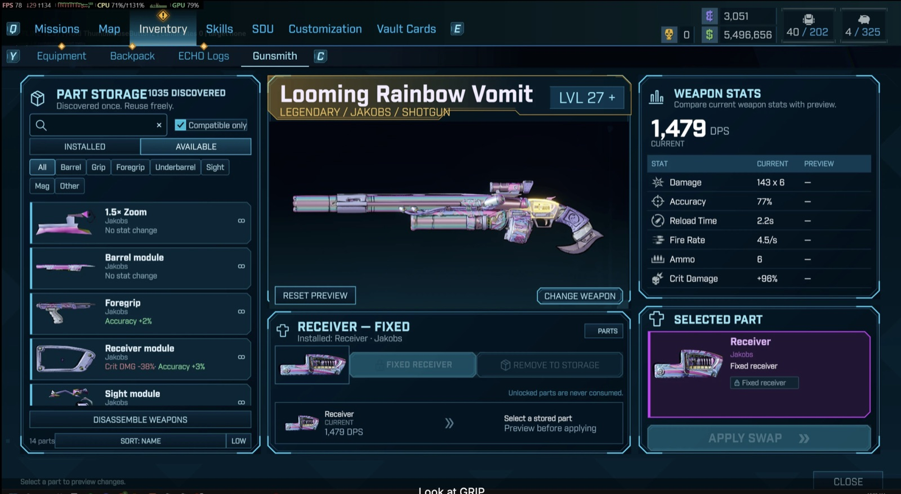

# Gunsmith

Gunsmith apporte la personnalisation des armes dans ton inventaire. Démonte les armes dont tu ne veux plus, découvre leurs pièces et remonte des armes compatibles selon ta façon de jouer.

{: width="1600" height="906" loading="lazy"}

## Ce qu'il fait

- **Découvre une fois, réutilise à volonté.** Démonter une arme débloque pour de bon les variantes de pièces récupérables. Pas de doublons à gérer : tes découvertes forment une collection réutilisable.
- **Vois le changement avant de valider.** L'aperçu d'arme du jeu lui-même montre l'arme. Survole une pièce pour la mettre en évidence, clique pour la choisir, compare les statistiques proposées, puis applique l'échange.
- **Trouve la pièce qui compte.** Les pièces installées et disponibles sont listées à part. Cherche, filtre par catégorie et trie par statistiques.
- **Transforme le butin inutile en pièces.** Démonte les armes choisies, ou toutes celles marquées comme camelote.
- **Mets une arme favorite à ton niveau.** Monte une arme prise en charge au niveau de ton personnage depuis l'établi.
- **Share Discoveries** (nouveau dans la 1.0.8). Active-le pour réunir les pièces débloquées par tous tes personnages et partager celles qu'ils découvriront ensuite.

Les échanges restent dans la même famille d'armes : démonter un revolver Jakobs peut débloquer des pièces pour d'autres revolvers Jakobs compatibles, mais un canon de fusil de précision ne va pas sur un pistolet.

{: width="1600" height="879" loading="lazy"}

## Comment s'en servir

Ouvre **Inventaire > Gunsmith**, à côté de l'onglet des journaux ECHO, ou survole la carte d'une arme et appuie sur **G**.

- Clic gauche : choisir une pièce.
- Bouton droit maintenu : faire tourner l'arme.
- Molette sur l'aperçu : zoomer.
- Molette sur la liste des pièces : faire défiler.
- **Reset Preview** remet la vue de départ ; **Change Weapon** choisit une autre arme.

Seules les armes non équipées peuvent être modifiées. Déplace d'abord l'arme de tes quatre emplacements d'arme vers ton sac.

## Installation

Gunsmith tourne en C++ natif, avec l'interface d'inventaire et l'aperçu d'arme du jeu lui-même. Il n'a besoin ni du SDK Python, ni d'une installation de Python, ni d'une activation dans un menu : le chargeur et les fichiers dont il a besoin sont fournis.

1. Ferme Borderlands 4.
2. Télécharge Gunsmith sur sa page Nexus et extrais-le.
3. Copie le dossier `OakGame` extrait dans le dossier d'installation de Borderlands 4, et laisse les dossiers fusionner.
4. Lance le jeu, charge ton personnage et ouvre **Inventaire > Gunsmith**.

Pour mettre à jour, ferme le jeu et copie la nouvelle version par-dessus l'ancienne. Les instructions complètes, y compris pour la désinstallation, sont sur la page Nexus.

## À savoir avant de commencer

- Sauvegarde tes parties. Le démontage détruit les armes, et la désinstallation ne les rend pas et n'annule pas les modifications d'armes enregistrées.
- Seules les pièces compatibles sont prises en charge ; mélanger des types d'armes différents n'est pas prévu.
- Les modules obligatoires et légendaires peuvent devoir être remplacés au lieu d'être retirés.
- La première utilisation des miniatures peut provoquer de brefs à-coups.
- Le multijoueur, la manette, les écrans ultra-larges et les autres versions du jeu n'ont pas encore été vérifiés.
- D'autres mods qui modifient l'interface de l'inventaire peuvent entrer en conflit.

La liste complète est sur la page Nexus.

## Signaler un bug

Signale les bugs sur la page Nexus, avec :

- ta version de Gunsmith ;
- ta version du jeu, et s'il s'agit de Steam ou d'Epic ;
- la langue de ton jeu ;
- le fichier `unrealsdk.log`.
