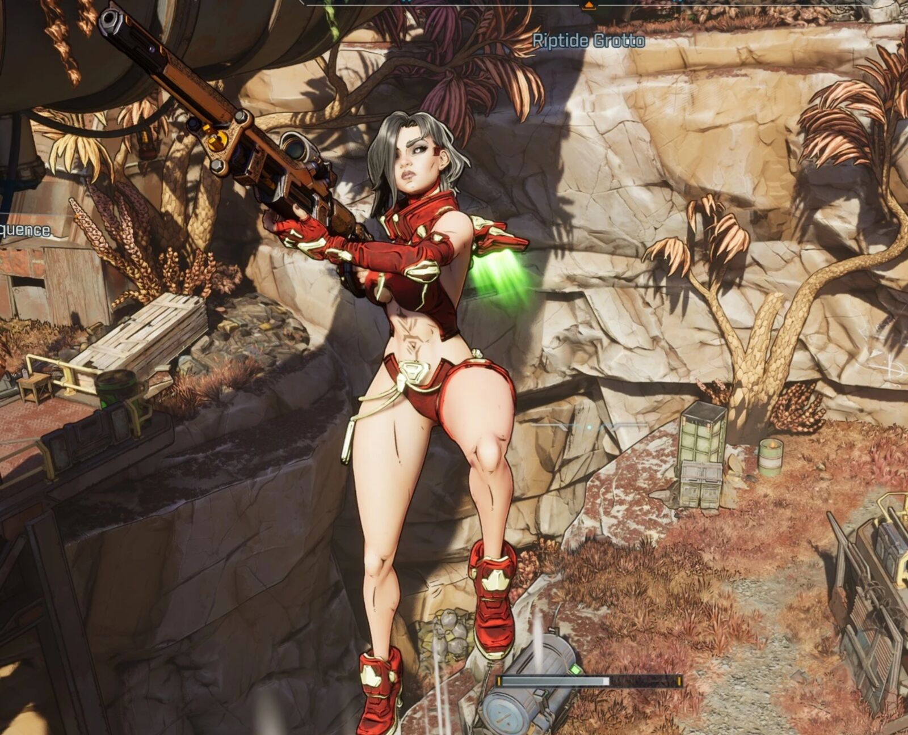

# Jetpack Ascend

Jetpack Ascend 让你可以真正借助滑翔背包（游戏里的喷气背包）向上飞，而不只是滑翔。抬头看即可上升；平视或向下看，则照常滑翔。它并不超模，只是一种更方便的移动方式。

{: width="1600" height="1296" loading="lazy"}

## 功能

- **抬头即可上升**。滑翔时瞄准地平线以上，滑翔背包就会带你向上飞。
- **其他情况照常滑翔**。平视或向下看时，滑翔与原版游戏相同。
- **依然会耗尽**。滑翔背包保留其能量条：上升和滑翔一样会消耗它，模组不会改变其消耗速度。
- **合作模式**。模组支持合作模式，只需主机安装。

## 设置

模组的选项中有两项设置：

- **Ascend Speed**：上升速度，范围 200 到 3,000（默认 900；100 约等于每秒 1 米）。
- **Look-Up Threshold (degrees)**：需要瞄准地平线以上多少度才会上升而不是滑翔，范围 0 到 80 度（默认 15 度）。

## 安装

Jetpack Ascend 需要 Oak2 Mod Manager：[安装指南](https://bl-sdk.github.io/oak2-mod-db/)。

1. 安装 Oak2 Mod Manager。
2. 从 Nexus 页面下载 Jetpack Ascend，将其中的 `.sdkmod` 文件放入游戏的 `sdk_mods` 文件夹（`...\Borderlands 4\sdk_mods`）。
3. 启动游戏。
4. 按两次控制台键（美式键盘上 Esc 下方的键）打开控制台，输入 `mods`，然后按回车。
5. 按下 JetpackAscend 旁边显示的数字。
